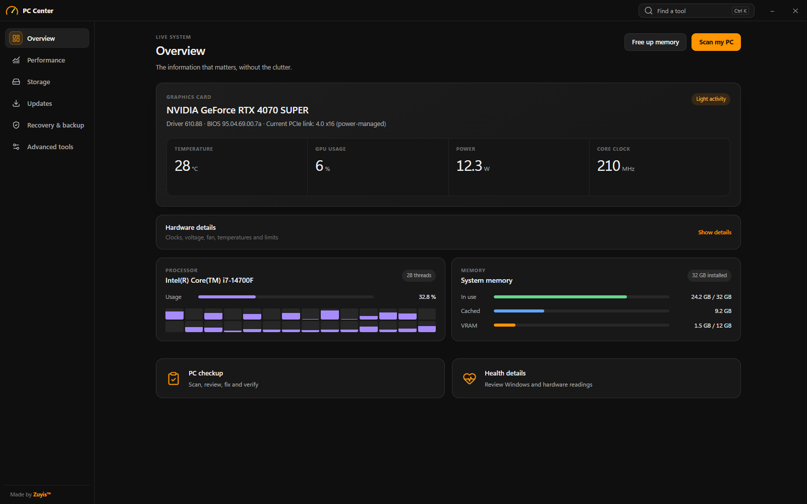
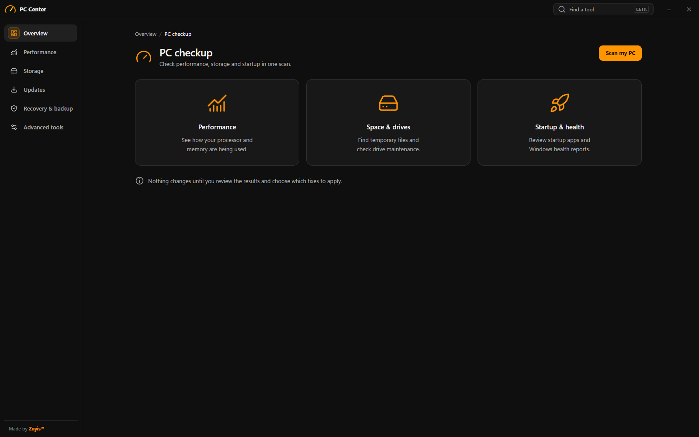
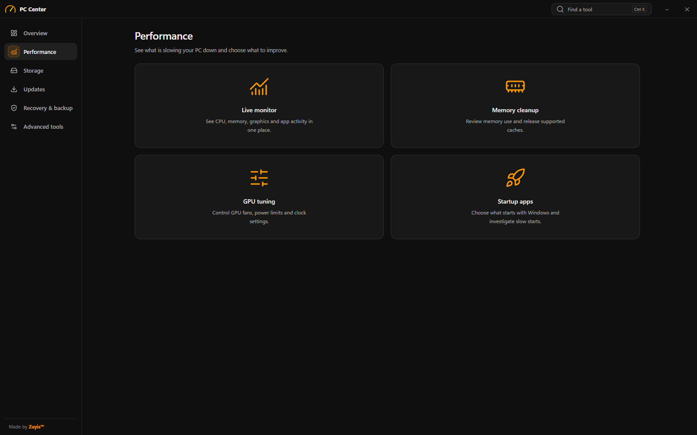
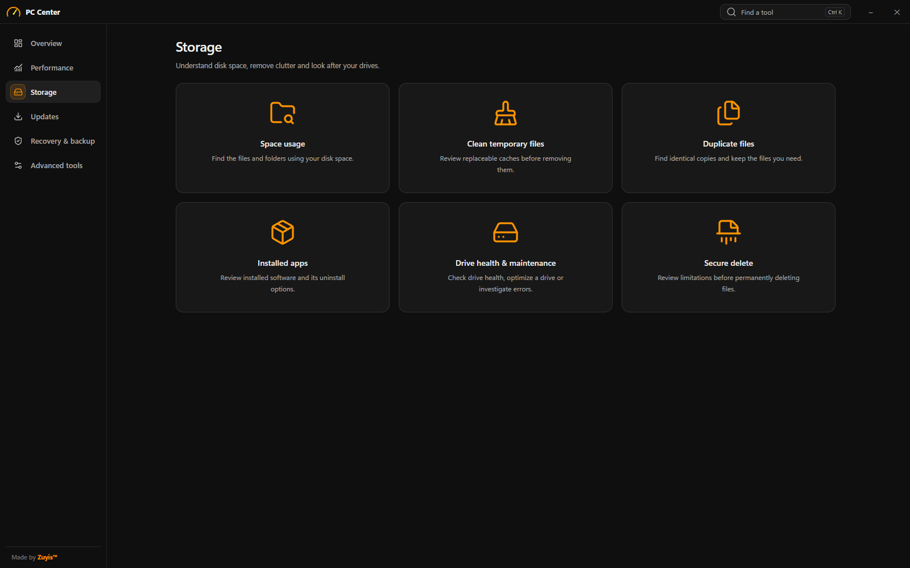
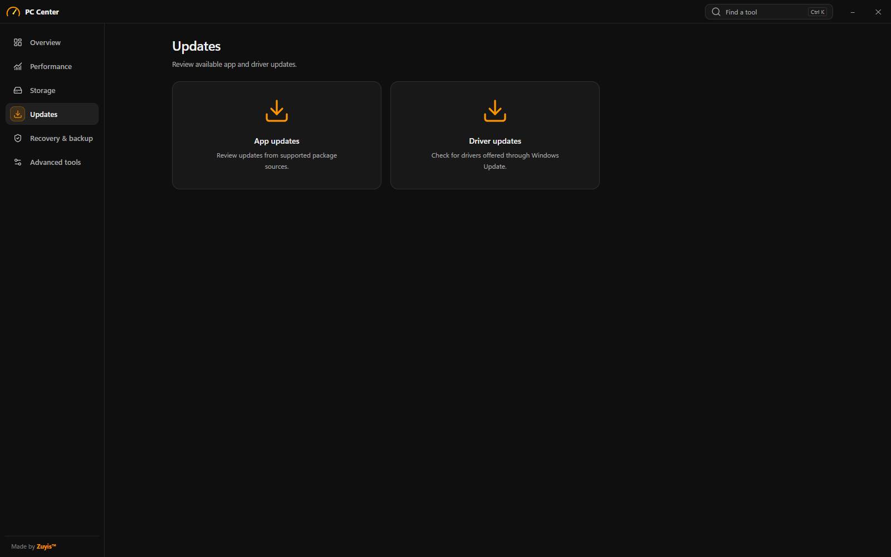
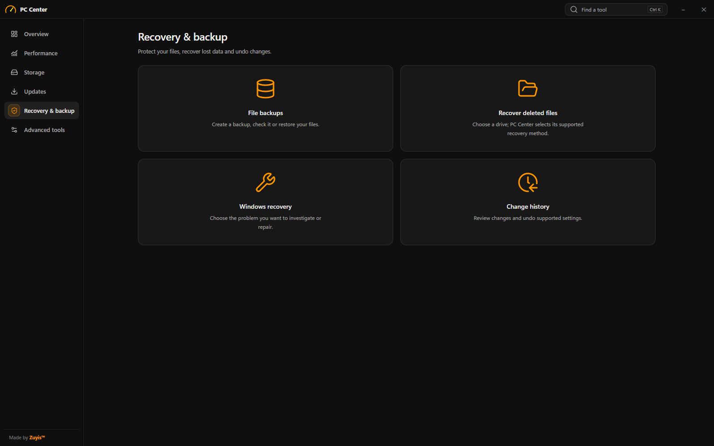
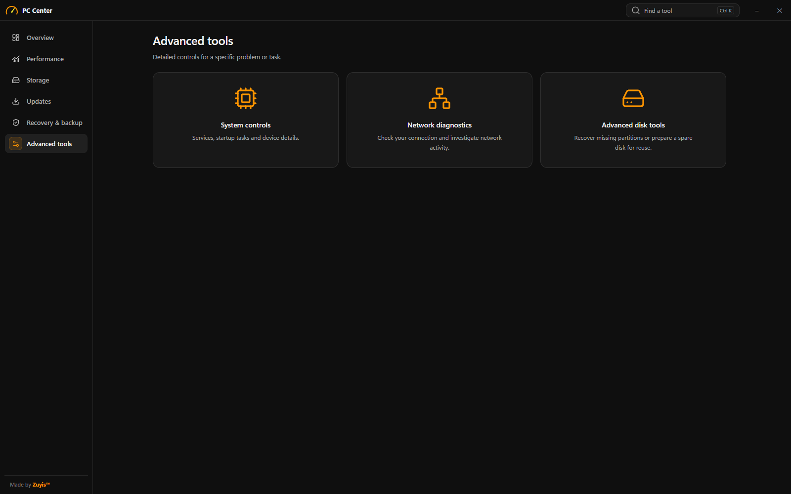

# PC Center

Understand your PC, find what needs attention, and choose what to change.

PC Center brings performance monitoring, storage tools, startup management,
backup and recovery into one Windows app. PC checkup guides you through
**scan → review → fix → verify**.

**[Download PC Center 0.14.9 for Windows](https://github.com/dukagjina/PC-Center/releases/download/v0.14.9/PC-Center-Setup.exe)**

[Release notes](https://github.com/dukagjina/PC-Center/releases/latest) ·
[Installation help](INSTALL.md) ·
[Report a problem](https://github.com/dukagjina/PC-Center/issues/new/choose)

**Requirements:** Windows 11 x64, administrator permission for installation,
and [Microsoft Edge WebView2 Runtime](https://developer.microsoft.com/en-us/microsoft-edge/webview2/#download-section).
This release is **unsigned**. Windows or your browser may show an unknown-publisher
or reputation warning; managed PCs may block it. See [installation help](INSTALL.md).

## Screenshots

The main pages in PC Center **0.14.9**. Select an image to view it at full size.
Overview shows live readings from the PC used for these screenshots; readings
and available hardware controls vary by device.

**Overview**

| PC checkup | Performance |
| --- | --- |
|  |  |
| **Storage** | **Updates** |
|  |  |
| **Recovery & backup** | **Advanced tools** |
|  |  |

## What you can do

| Area | Tools |
| --- | --- |
| PC checkup | Scan activity, cleanup locations, startup entries and drive health; review selected fixes and verify their results. |
| Performance | Watch live resource use, free memory, and inspect supported GPU readings and controls. |
| Storage | Explore space usage, find large or duplicate files, clean selected data, and check or optimize supported drives. |
| Startup and updates | Review startup apps and scheduled entries, inspect installed software, and check supported app and driver updates. |
| Recovery & backup | Back up and restore files, recover supported deleted data, and undo supported settings changes. |
| Advanced tools | Inspect Windows services, network activity, hardware information and maintenance options. |

Scans let you review findings before applying fixes. Hardware controls depend on
your GPU and driver. File recovery depends on the drive and filesystem, and on
whether deleted data has been overwritten or discarded. Cleanup frees storage;
it does not guarantee a faster PC.

## Get started

1. Download **PC-Center-Setup.exe** using the link above.
2. Install WebView2 from Microsoft if setup reports that it is missing.
3. Run the installer and approve the Windows administrator prompt if you choose to install.
4. Open **PC Center** from your Desktop or Start menu, then choose **Scan my PC**.

The installer installs a Windows background service for privileged operations
and adds PC Center tools under Explorer's **Show more options** menu.
Uninstall through **Windows Settings → Apps → Installed apps → PC Center**.

## Privacy, support and license

PC Center processes scans on your PC. It has no advertising or usage-analytics
uploader. Update checks contact GitHub, Microsoft and applicable software
publishers. Read the full [privacy notice](PRIVACY.md).

For ordinary problems, [open an issue](https://github.com/dukagjina/PC-Center/issues/new/choose).
For vulnerabilities, use [private security reporting](https://github.com/dukagjina/PC-Center/security/advisories/new).

PC Center is free for personal and other permitted noncommercial use under the
[PolyForm Noncommercial License 1.0.0](LICENSE). Commercial use requires separate
permission; see [commercial-use terms](COMMERCIAL_USE.md).
[Third-party notices](THIRD_PARTY_NOTICES.md) and [trademark terms](TRADEMARKS.md) apply.

This repository contains official downloads, release documentation and support.
GitHub's automatically generated source archives contain this repository's
documentation; download the **EXE asset** to install the application.
